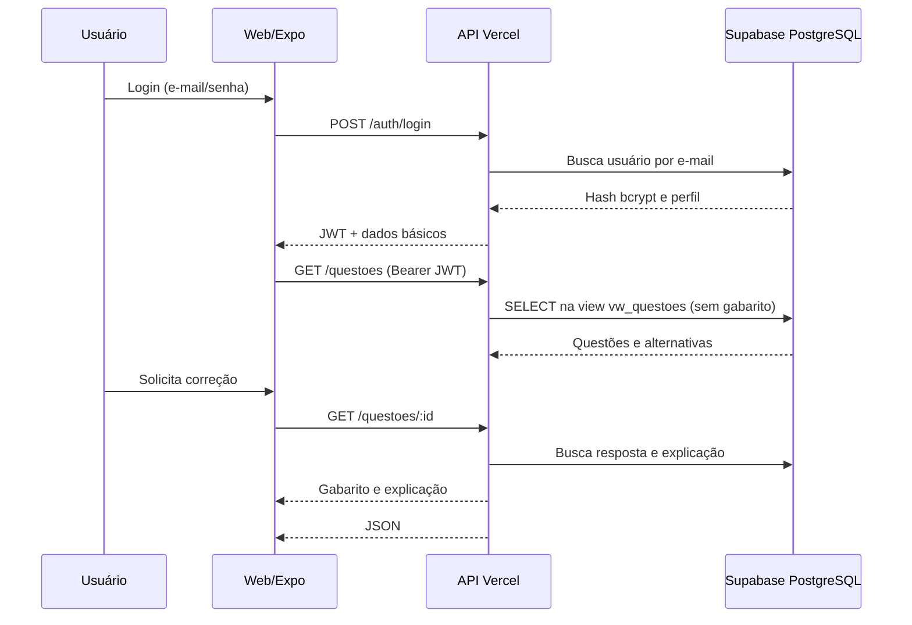
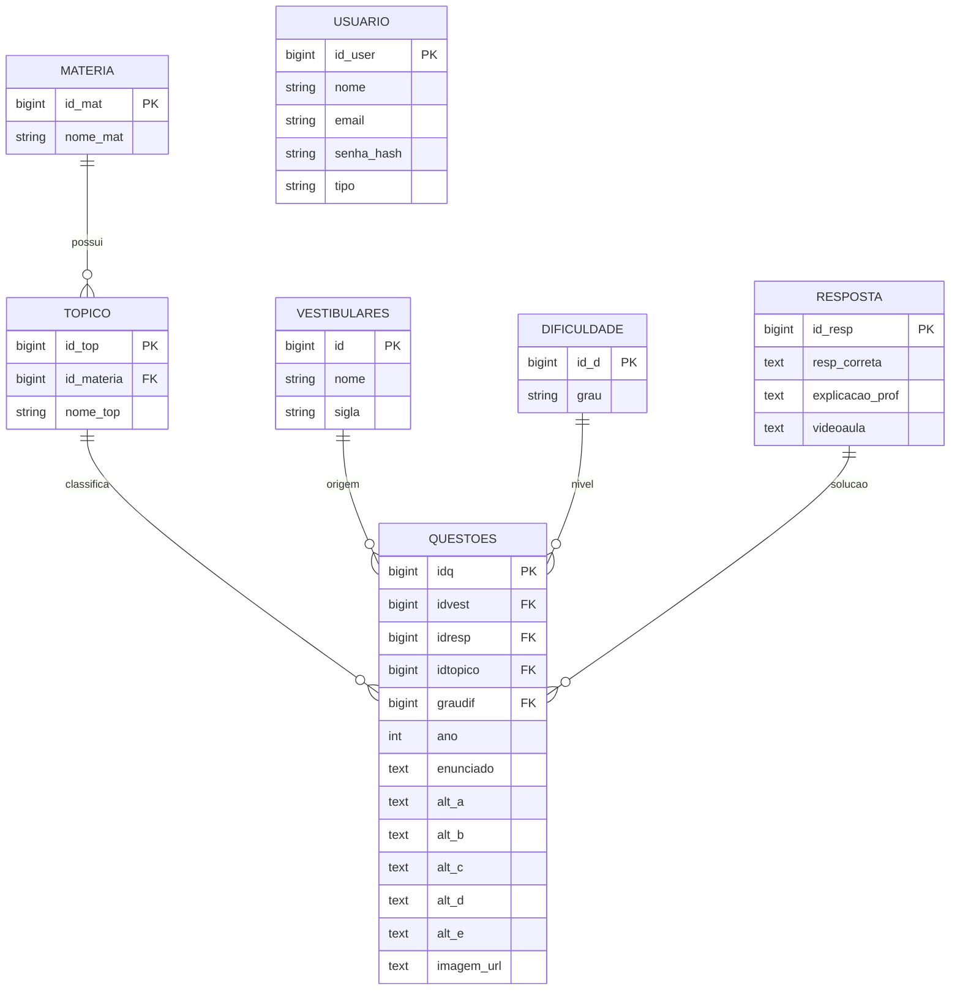

# Documentação técnica — BuscFísica

## Visão geral
O BuscFísica permite que estudantes pratiquem questões de Física organizadas por vestibular, matéria e tópico, consultem explicações e videoaulas e acessem um catálogo de fórmulas. A autenticação é centralizada na API e compartilhada entre web e mobile por JWT.

## Fluxo de comunicação

## Componentes

| Camada | Tecnologia | Responsabilidade |
|---|---|---|
| Web | React, Vite, React Router | Interface web responsiva |
| Mobile | React Native, Expo | Interface Android/iOS |
| API | Node.js, Express | Regras, autenticação, validação e acesso ao banco |
| Banco | Supabase PostgreSQL | Persistência relacional |
| Infra | Vercel | Hospedagem e deploy contínuo |
| DNS/SSL | Provedor de domínio + Vercel | Resolução do domínio e HTTPS |

## Modelo relacional

## Dicionário de dados

- `usuario`: identidade, e-mail único, hash de senha, perfil (`user` ou `admin`) e data de criação.
- `materia`: catálogo de áreas de Física.
- `topico`: tópico pertencente a uma matéria; combinação matéria/nome única.
- `vestibulares`: instituição e sigla única.
- `dificuldade`: níveis Fácil, Médio e Difícil.
- `resposta`: alternativa correta, explicação e URL opcional de videoaula.
- `questoes`: enunciado, alternativas, ano, imagem opcional e referências às tabelas de catálogo/resposta.
- `vw_questoes`: view de listagem que combina questão, vestibular, tópico, matéria e dificuldade sem expor o gabarito. A resposta é consultada separadamente no detalhe autenticado da questão.

## Integridade e índices
As PKs são identity; FKs impedem referências inexistentes; campos essenciais são NOT NULL; e-mail/sigla são UNIQUE; dificuldade usa CHECK; ano possui faixa de validação. Índices apoiam filtros e joins de questões por vestibular, tópico e dificuldade.

## Autenticação e autorização
`POST /auth/login` valida bcrypt e emite JWT com validade de quatro horas. As rotas de catálogo e questões exigem `Authorization: Bearer <token>`. Alteração/criação/exclusão de questões e consulta administrativa de usuários exigem perfil `admin`. A criação de conta pública só gera perfil `user`.

## Implantação
O frontend e a API são projetos separados na Vercel. O frontend recebe `VITE_API_URL`; a API recebe `DATABASE_URL`, `JWT_SECRET`, `NODE_ENV` e `FRONTEND_ORIGIN`. O aplicativo Expo recebe `EXPO_PUBLIC_API_URL` e `EXPO_PUBLIC_WEB_URL` em seu ambiente de build; a segunda variável permite carregar as imagens de apoio hospedadas junto ao frontend. O domínio e os registros DNS devem seguir os valores indicados pelo painel Vercel.
